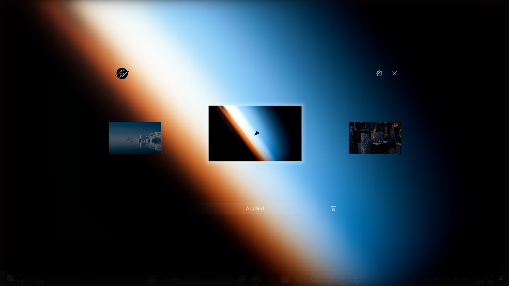
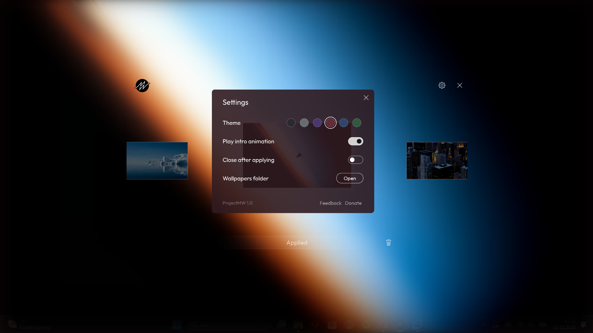

# ProjectMW

A calm, minimal wallpaper picker for Windows, inspired by the PSP's XMB menu.

https://github.com/user-attachments/assets/f16ed9ab-d98b-4888-b07f-ba00c12367ea

Open ProjectMW and your desktop dims behind a single row of wallpapers. Glide through them, stop on the one you like and press Apply. A soft light sweeps across the screen and your new wallpaper is in place.



## Download

Get the latest installer from the [Releases page](https://github.com/EmreBerkA/ProjectMW/releases/latest).

- **Setup:** `ProjectMW-1.0.0-Setup.exe` installs for your user only, no admin rights needed.
- **Portable:** unzip `ProjectMW-1.0.0-Portable.zip` anywhere and run `ProjectMW.exe`.

Requires Windows 10 or 11 (64-bit).

> Windows SmartScreen may warn you because the app is new and not code-signed. Click **More info** and then **Run anyway**. SHA256 hashes of every file are listed on the release page.

## Features

- **Coverflow gallery:** drag with the mouse, scroll with a touchpad or use the arrow keys. A card always settles in the center.
- **One-click apply:** the chosen picture becomes your Windows wallpaper with a gentle light effect, without freezing the app.
- **Your own library:** add pictures with the + button. They are copied into the app's library, so your originals stay untouched.
- **Themes:** six muted color themes (Dark, Silver, Purple, Bordeaux, Blue, Green).
- **Small touches:** an animated intro (can be turned off), close after applying, update notifications, keyboard shortcuts.



## Keyboard

| Key | Action |
| --- | --- |
| ← / → | Previous / next wallpaper |
| Enter | Apply the centered wallpaper |
| Delete | Remove the centered wallpaper |
| Esc | Close |

## Where are my files?

Your wallpapers and settings live in `%APPDATA%\ProjectMW`. Uninstalling the app keeps them, so nothing is lost if you reinstall. Delete that folder if you want a clean removal.

## Feedback and support

Found a bug or have an idea? Use **Settings > Feedback** inside the app or [open an issue](https://github.com/EmreBerkA/ProjectMW/issues).

ProjectMW is free. If you enjoy it, you can [buy me a coffee](https://buymeacoffee.com/emreberk).

## Building from source

```
python -m venv .venv
.venv\Scripts\pip install -r requirements.txt
.venv\Scripts\python main.py
```

To build the installer, install [Inno Setup 6](https://jrsoftware.org/isinfo.php) and run `build.bat`.

## License

ProjectMW is released under the [MIT License](LICENSE). Third-party components are listed in [THIRD_PARTY_NOTICES.txt](THIRD_PARTY_NOTICES.txt).
